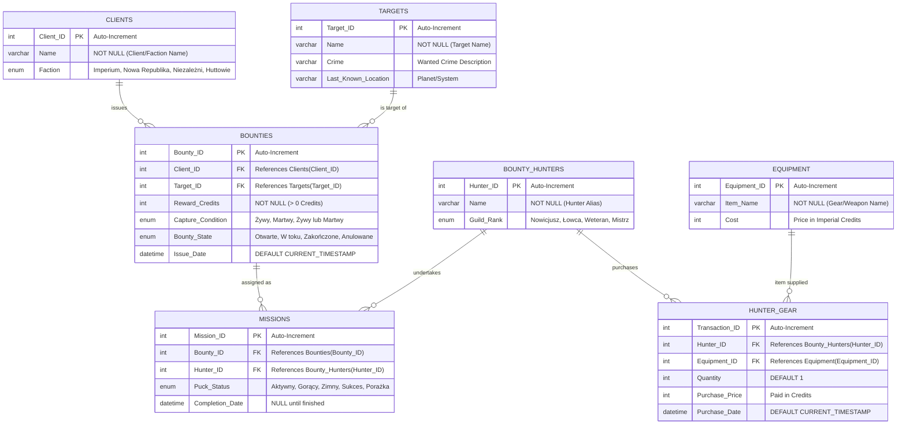

# 🗄️ Star Wars Guild - Database Schema & ERD

This document provides a detailed breakdown of the relational database architecture powering the **Star Wars Bounty Hunter Guild Management System**, including the interactive Entity-Relationship Diagram (ERD), table dictionaries, integrity constraints, and automated triggers.

---

## 📊 Entity-Relationship Diagram (ERD)

---

## 📑 Data Dictionary

### 1. `Clients` (Dictionary / Entity)
Stores entities and factions commissioning bounties across the galaxy.
| Column | Type | Constraints | Description |
| :--- | :--- | :--- | :--- |
| `Client_ID` | `INT` | `PK`, `AUTO_INCREMENT` | Unique identifier of the client |
| `Name` | `VARCHAR(100)` | `NOT NULL` | Name of the issuing patron |
| `Faction` | `ENUM` | `DEFAULT 'Niezależni'` | Affiliation (`Imperium`, `Nowa Republika`, `Niezależni`, `Huttowie`) |

### 2. `Targets` (Dictionary / Entity)
Individuals or fugitives with an active tracking puck or warrant.
| Column | Type | Constraints | Description |
| :--- | :--- | :--- | :--- |
| `Target_ID` | `INT` | `PK`, `AUTO_INCREMENT` | Unique identifier of the target |
| `Name` | `VARCHAR(100)` | `NOT NULL` | Target identity / alias |
| `Crime` | `VARCHAR(255)` | `NULL` | Alleged criminal offense or justification |
| `Last_Known_Location`| `VARCHAR(100)` | `NULL` | Planet, sector, or outpost |

### 3. `Bounty_Hunters` (Core Entity)
Registered members of the Bounty Hunters Guild holding varying ranks.
| Column | Type | Constraints | Description |
| :--- | :--- | :--- | :--- |
| `Hunter_ID` | `INT` | `PK`, `AUTO_INCREMENT` | Unique guild license identifier |
| `Name` | `VARCHAR(100)` | `NOT NULL` | Hunter's name / Mandalorian moniker |
| `Guild_Rank` | `ENUM` | `DEFAULT 'Nowicjusz'` | Hierarchy (`Nowicjusz`, `Łowca`, `Weteran`, `Mistrz`) |

### 4. `Equipment` (Dictionary / Inventory)
Arsenal, Beskar armor, and tracking tools available from the Guild Armorer.
| Column | Type | Constraints | Description |
| :--- | :--- | :--- | :--- |
| `Equipment_ID` | `INT` | `PK`, `AUTO_INCREMENT` | Item serial number |
| `Item_Name` | `VARCHAR(100)` | `NOT NULL` | Weapon/gear name (e.g., Beskar Pauldron, Amban Rifle) |
| `Cost` | `INT` | `NOT NULL` | Base price in Imperial Credits |

### 5. `Bounties` (Operational Contract Table)
Core contract connecting an issuing Client and a wanted Target.
| Column | Type | Constraints | Description |
| :--- | :--- | :--- | :--- |
| `Bounty_ID` | `INT` | `PK`, `AUTO_INCREMENT` | Contract identifier |
| `Client_ID` | `INT` | `FK -> Clients(Client_ID)` | Client issuing contract (`ON DELETE CASCADE`) |
| `Target_ID` | `INT` | `FK -> Targets(Target_ID)` | Target of contract (`ON DELETE CASCADE`) |
| `Reward_Credits` | `INT` | `NOT NULL` | Bounty reward (validated $>0$) |
| `Capture_Condition` | `ENUM` | `NOT NULL` | `Żywy`, `Martwy`, `Żywy lub Martwy` |
| `Bounty_State` | `ENUM` | `DEFAULT 'Otwarte'` | Contract progress (`Otwarte`, `W toku`, `Zakończone`, `Anulowane`) |
| `Issue_Date` | `DATETIME` | `DEFAULT CURRENT_TIMESTAMP` | Date and time of posting |

### 6. `Missions` (Assignment Junction Table)
Represents a hunter taking on an active tracking puck for a specific bounty.
| Column | Type | Constraints | Description |
| :--- | :--- | :--- | :--- |
| `Mission_ID` | `INT` | `PK`, `AUTO_INCREMENT` | Mission tracking number |
| `Bounty_ID` | `INT` | `FK -> Bounties(Bounty_ID)` | Contract pursued (`ON DELETE CASCADE`) |
| `Hunter_ID` | `INT` | `FK -> Bounty_Hunters(Hunter_ID)` | Hunter assigned (`ON DELETE CASCADE`) |
| `Puck_Status` | `ENUM` | `DEFAULT 'Aktywny'` | Status (`Aktywny`, `Gorący`, `Zimny`, `Sukces`, `Porażka`) |
| `Completion_Date` | `DATETIME` | `NULL` | Completion timestamp |

### 7. `Hunter_Gear` (Inventory Junction Table - M:N)
Associates hunters with purchased equipment and logs transaction history.
| Column | Type | Constraints | Description |
| :--- | :--- | :--- | :--- |
| `Transaction_ID` | `INT` | `PK`, `AUTO_INCREMENT` | Receipt identifier |
| `Hunter_ID` | `INT` | `FK -> Bounty_Hunters(Hunter_ID)`| Buyer (`ON DELETE CASCADE`) |
| `Equipment_ID` | `INT` | `FK -> Equipment(Equipment_ID)` | Item (`ON DELETE CASCADE`) |
| `Quantity` | `INT` | `DEFAULT 1` | Units acquired |
| `Purchase_Price` | `INT` | `NOT NULL` | Final cost paid |
| `Purchase_Date` | `DATETIME` | `DEFAULT CURRENT_TIMESTAMP` | Transaction timestamp |

---

## ⚡ Automated Business Logic & Triggers

The schema enforces domain business rules and data consistency directly at the database engine level:

1. **`check_bounty_reward` (`BEFORE INSERT ON Bounties`):**
   Prevents fraudulent contracts by raising an SQL error if `Reward_Credits <= 0`.
2. **`check_hunter_name` (`BEFORE INSERT ON Bounty_Hunters`):**
   Ensures no anonymous or blank guild hunter records can be inserted.
3. **`Trg_Zamknij_Zlecenie` (`AFTER INSERT ON Missions`):**
   Automatically updates `Bounties.Bounty_State = 'Zakończone'` whenever a mission is registered with `Puck_Status = 'Sukces'`.
4. **`Raport_Zlecen` (View):**
   Pre-compiled 3-table `JOIN` view aggregating Bounty, Client, and Target details for rapid reporting.
