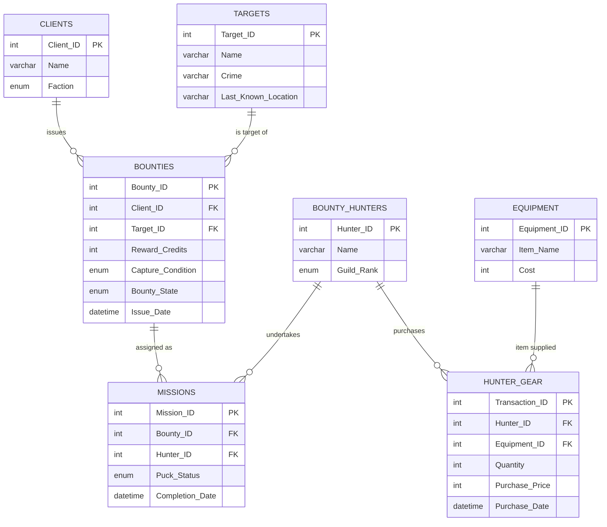
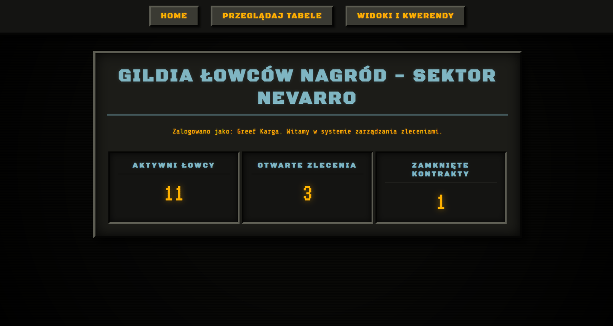
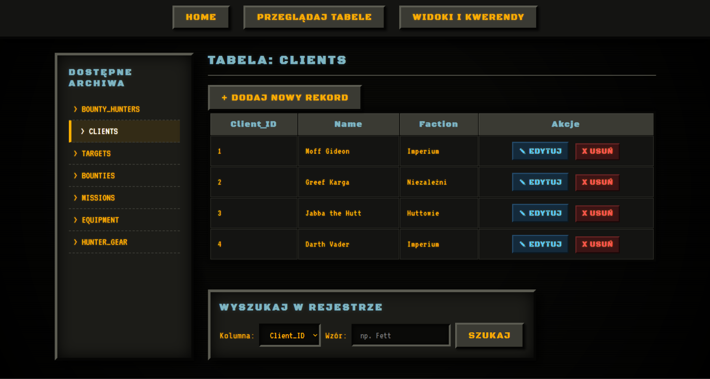
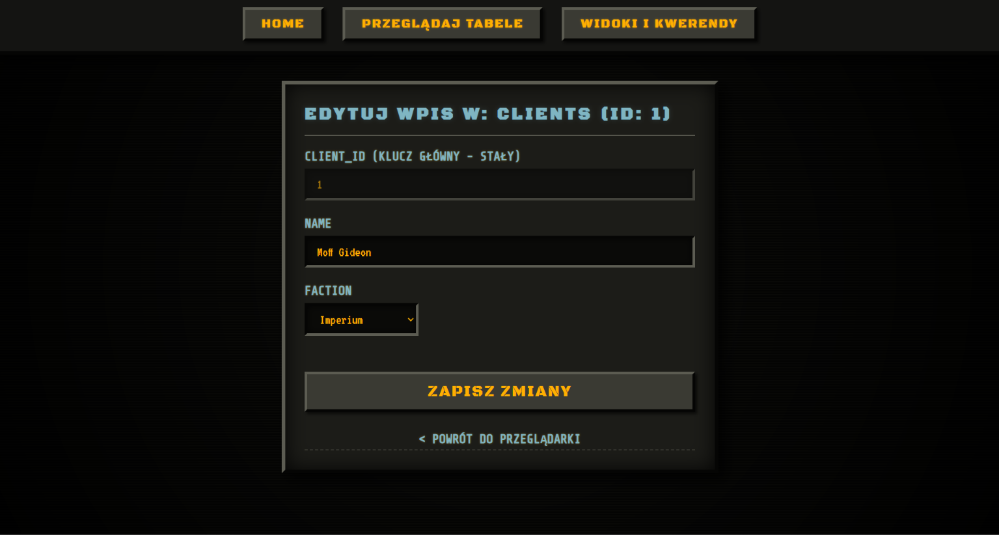
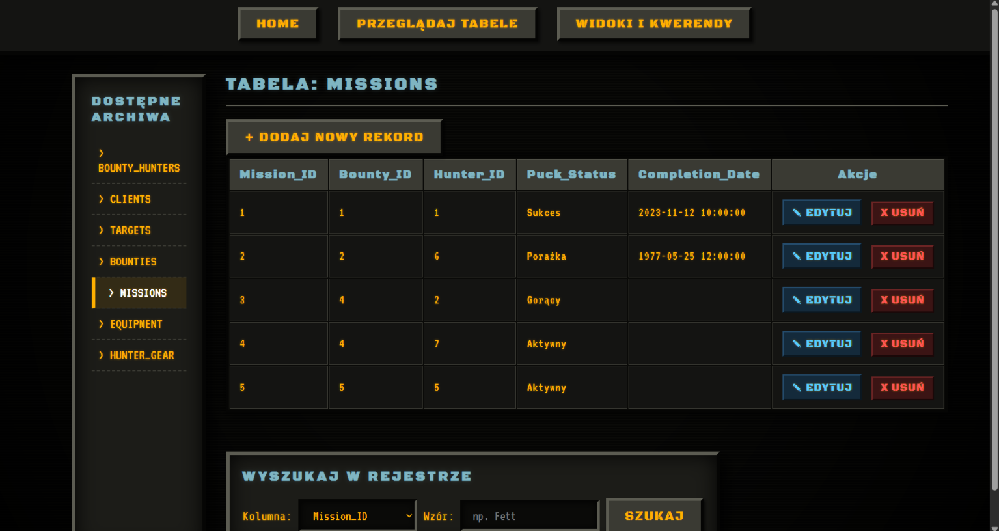
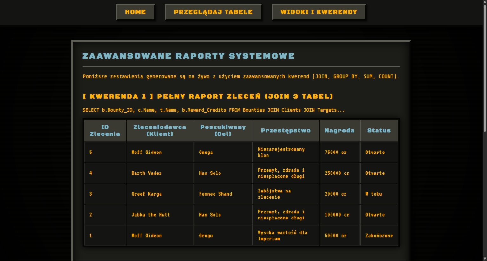

# Star Wars Bounty Hunter Guild - Management System

A web-based CRUD (Create, Read, Update, Delete) application designed to manage a fictional Bounty Hunter Guild database set in the Star Wars universe. This project demonstrates backend web development skills utilizing **PHP**, a relational **MySQL** database, and pure CSS for styling.

## 🌟 Features

* **Relational Database Design:** A fully structured MySQL database featuring foreign key constraints, cascading deletes, and ENUM types for data integrity (e.g., Guild Ranks, Factions).
* **Dynamic Table Views & Search:** Browse complex data including Hunters, Bounties, Clients, and Equipment with column-based live filtering directly from the web interface.
* **Full CRUD Operations:**
  * **Create:** Add new records via dynamically generated HTML forms (`add_record.php`) with automated dropdown foreign key lookups.
  * **Read:** View tabular sector archives (`view_table.php`) with formatted data representations.
  * **Update:** Edit existing records in-place (`edit_record.php`) with pre-filled forms and persistent primary key protection.
  * **Delete:** Safely remove obsolete archive entries (`delete_record.php`) honoring foreign key cascades.
* **Secure Database Layer:** Prepared statements (MySQLi) utilized across add, edit, delete, and search queries to prevent SQL Injection vulnerabilities.
* **Complex SQL Queries:** Pre-built advanced reporting views accessible via the UI (`queries.php`) utilizing multi-table `JOIN`, `GROUP BY`, `SUM`, and `COUNT` aggregations.
* **Data Seed:** Includes CSV data dumps (`database/data_imports`) to quickly populate the database with lore-friendly Star Wars data (Mandalorian, Boba Fett, IG-11, etc.).

## 🛠️ Technology Stack
* **Backend:** PHP 8+ (MySQLi with Prepared Statements)
* **Database:** MySQL / MariaDB (SQL script provided)
* **Frontend:** HTML5, pure CSS (`assets/css/style.css`) with Star Wars sci-fi terminal styling
* **Architecture:** Modular PHP includes (`header.php`, `navbar.php`, `footer.php`) and a central database configuration (`config/db.php`).

## 🗄️ Database Schema & Interactive ERD

The relational database architecture is defined across 7 normalized tables interconnected via strict foreign key constraints and cascading operations.

### Visual ERD (Rendered natively via Mermaid)

> 📖 **Full Schema Specification:** Detailed column constraints, indexes, triggers (`BEFORE INSERT`, `AFTER INSERT`), and data dictionaries are documented in [DATABASE_SCHEMA.md](DATABASE_SCHEMA.md).

## 📸 Screenshots

*Figure 1: Main Guild terminal dashboard and navigation hub.*

*Figure 2: Dynamic archive table view with in-place Edit and Delete action triggers.*

*Figure 3: Dynamic record editing interface with automated foreign key resolution.*

*Figure 4: Complex mission data presentation with status badges and contract details.*

*Figure 5: Live multi-table reporting utilizing SQL JOINs and GROUP BY aggregations.*

## 🚀 How to Run (Local Environment)

1. **Install a Local Server:** Use [XAMPP](https://www.apachefriends.org/index.html) or a similar LAMP/WAMP stack.
2. **Setup Database:**
   * Open phpMyAdmin (usually `http://localhost/phpmyadmin`).
   * Import the SQL script: `database/schema.sql`. This will automatically create the `star_wars_guild` database and build the table structures.
   * *(Optional)* Import the provided `.csv` files from `database/data_imports` into their respective tables if you want initial data.
3. **Deploy the App:**
   * Clone or copy this repository into your local web root folder:
     `C:\xampp\htdocs\Star-Wars-Guild-PHP-CRUD`
4. **Configure Connection:**
   * Ensure the credentials in `config/db.php` match your local MySQL setup (default for XAMPP is user: `root`, password: `[empty]`).
5. **Run:**
   * Open your browser and navigate to:
     `http://localhost/Star-Wars-Guild-PHP-CRUD/index.php`
